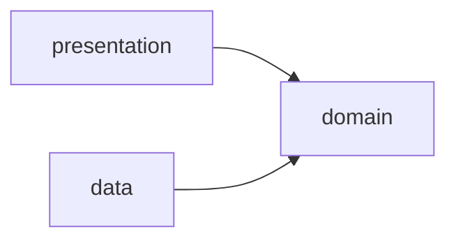

# Kade Ledger: Design

See [PLAN.md](PLAN.md) for the visual screen wireframes, architecture diagrams, and step-by-step phase roadmap.

## 1. What the app is

An offline-first mobile app for small shop owners in Sri Lanka. It replaces the credit notebook: the owner records customers, credit sales and payments, sees what each customer owes, tracks simple stock, sees a dashboard, and shares a PDF statement with a customer (for example on WhatsApp). It works fully offline, and later syncs to the cloud.

## 2. Use cases

1. Add, edit, search and soft-delete customers
2. Record a credit sale (amount, note, date, optional due date) for a customer
3. Record a payment for a customer
4. See each customer's balance (credits minus payments) and their history
5. Track stock items and flag low stock
6. Dashboard: total owed, today's totals, top debtors, a simple chart
7. Build and share a PDF statement for a customer
8. Reminders for due payments (local notifications)
9. Cloud backup and sync (Supabase), invisible to the user
10. English UI first, Sinhala later

## 3. Screens

Customers list, Customer detail (big balance, Add credit and Record payment buttons, history, Share statement), Customer form, Items list, Item form, Dashboard, Statement preview, Settings.

Bottom navigation: Customers, Items, Dashboard.

Design rules:
- The balance is the biggest number on the customer detail screen.
- Money owed is shown in the danger color and payments in the success color.
- Buttons start with a verb.
- Sentence case everywhere.
- Every screen handles loading, empty and error states.

## 4. Architecture

Feature-first folders with three layers per feature:

- **presentation**: screens, widgets, Riverpod Notifiers
- **domain**: plain Dart entities, use cases, repository interfaces
- **data**: Drift tables, repository implementations

Dependencies point inward: presentation and data depend on domain, domain depends on nothing. Presentation never imports data.

Use cases hold business rules: amount greater than zero, name required, balance computed from transactions and never stored, soft delete only.

The UI reads and writes only the local Drift database, and screens watch Drift streams so they update automatically after a write.

## 5. Data

| Table | Fields |
|---|---|
| customers | id, name, phone, note, createdAt, updatedAt, deletedAt |
| transactions | id, customerId, type (`credit` or `payment`), amountMinor, note, date, dueDate, createdAt, updatedAt, deletedAt |
| items | id, name, unitPriceMinor, quantity, lowStockThreshold, createdAt, updatedAt, deletedAt |

- UUID v4 string keys.
- Money as integer minor units (rupees x 100), never `double`.
- Every schema change needs a Drift migration and a migration test.
