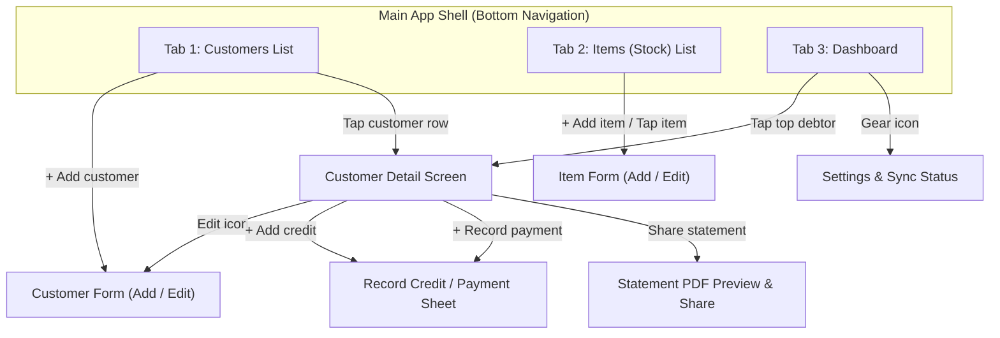
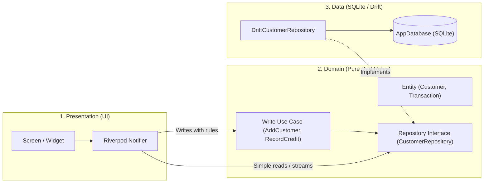
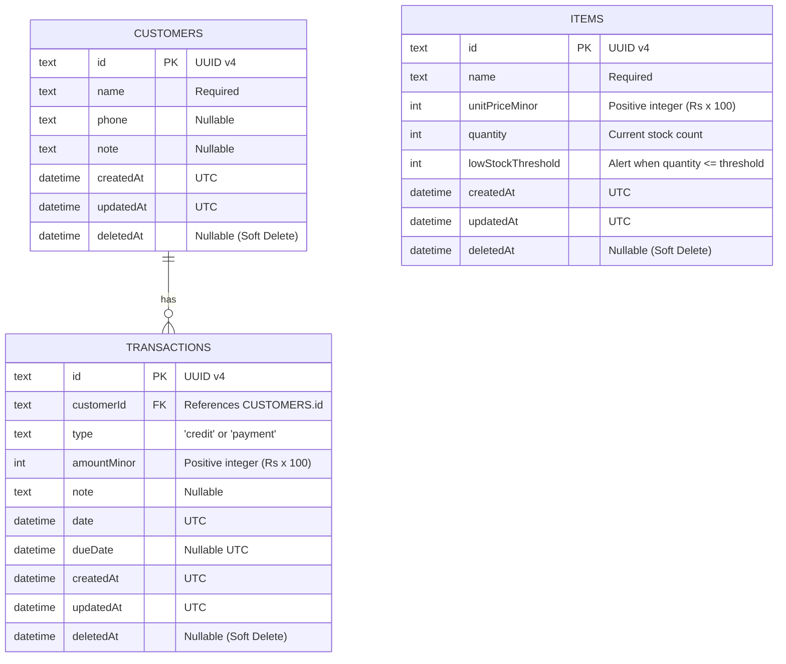

# Kade Ledger — Master Architecture, UI & Execution Plan

> [!IMPORTANT]
> **Goal:** Build an offline-first mobile credit book and stock tracker for Sri Lankan small shop owners (*kades*). Everything works 100% offline on the phone's SQLite database first, with optional Supabase cloud backup added in Phase 3.
> **Money Format:** All money is stored as integer minor units (`amountMinor`, rupees × 100) and displayed as `Rs. 1,250.00`.

---

## 1. Visual UI Map & Screen Wireframes

The app has a **3-tab Bottom Navigation Bar** (`Customers`, `Items`, `Dashboard`) plus detail/form screens pushed on top.



### Key Screen Layouts (What the user actually sees)

#### 1. Customers List Screen (Phase 1c & 1d)
- **In Phase 1c:** Shows each customer's **name** and **phone** only (no balance yet, never fake data). Tapping a customer opens the Edit Customer form.
- **In Phase 1d (once transactions exist):** Adds the real computed balance (`Rs. 1,250.00`) next to each customer and tapping opens the Customer Detail screen.
- Search bar filters by name or phone in real time.
- Floating button: **Add customer**.

```text
+---------------------------------------+
| Customers                         [*] |
+---------------------------------------+
| [ Search name or phone...           ] |
+---------------------------------------+
| Kamal Perera            Rs. 1,250.00  |
| 077 123 4567               (Phase 1d) |
+---------------------------------------+
| Nimali Silva                Rs. 0.00  |
| 071 987 6543               (Phase 1d) |
+---------------------------------------+
| Sunil Bandara             Rs. 450.00  |
| 075 555 1212               (Phase 1d) |
+---------------------------------------+
|                      [+ Add customer] |
+---------------------------------------+
| [Customers]    [Items]    [Dashboard] |
+---------------------------------------+
```

#### 2. Customer Detail Screen (Phase 1d)
- **Biggest number on screen:** Computed balance (`credits - payments`), formatted as `Rs. 1,250.00`.
- Action buttons start with a verb: **Add credit**, **Record payment**, **Share statement**.
- Chronological transaction history below.

```text
+---------------------------------------+
| <- Kamal Perera          [Edit] [Del] |
+---------------------------------------+
|            CURRENT BALANCE            |
|           Rs. 1,250.00                |
|         (Big Danger Red Text)         |
+---------------------------------------+
| [ + Add credit ]  [ + Record payment] |
|   (Danger btn)       (Success btn)    |
+---------------------------------------+
| [ Share statement (PDF)             ] |
+---------------------------------------+
| HISTORY                               |
| 17 Nov • Credit (Rice 5kg) +Rs. 1,500.00|
|          Due: 24 Nov                  |
| 15 Nov • Payment (Cash)     -Rs. 250.00 |
+---------------------------------------+
```

#### 3. Items (Stock) Screen (Phase 2)
- Tracks `unitPriceMinor`, `quantity`, and `lowStockThreshold`.
- Automatically flags items where `quantity <= lowStockThreshold`.

```text
+---------------------------------------+
| Items                             [+] |
+---------------------------------------+
| Samba Rice 5kg           Rs. 1,150.00 |
| Qty: 3  [LOW STOCK <= 5]   (Warning)  |
+---------------------------------------+
| Red Dhal 1kg               Rs. 380.00 |
| Qty: 24                               |
+---------------------------------------+
| Sugar 1kg                  Rs. 290.00 |
| Qty: 0  [OUT OF STOCK]     (Danger)   |
+---------------------------------------+
| [Customers]    [Items]    [Dashboard] |
+---------------------------------------+
```

#### 4. Dashboard Screen (Phase 2)
- Summary cards: **Total owed** across all customers, **Today's credit** (and today's payments).
- Bar/line chart (`fl_chart`) and Top Debtors list.

```text
+---------------------------------------+
| Dashboard                  [Settings] |
+---------------------------------------+
| +-----------------+ +---------------+ |
| | TOTAL OWED      | | TODAY'S CREDIT| |
| | Rs. 42,800.00   | | +Rs. 3,400.00 | |
| +-----------------+ +---------------+ |
+---------------------------------------+
| LAST 7 DAYS (Credit vs Payment Chart) |
|   ||   ..   ||   ..   ||              |
|   ||   ||   ||   ||   ||              |
+---------------------------------------+
| TOP DEBTORS                           |
| 1. Kamal Perera          Rs. 8,500.00 |
| 2. Saman Kumara          Rs. 6,200.00 |
+---------------------------------------+
| [Customers]    [Items]    [Dashboard] |
+---------------------------------------+
```

---

## 2. How the 3-Layer Architecture Works

Each feature (`customers`, `transactions`, `items`, etc.) is split into `domain/`, `data/`, and `presentation/`:



| Layer | Folder | Allowed Imports | What Lives Here |
|---|---|---|---|
| **Domain** | `lib/features/<feature>/domain/` | Pure Dart only (`dart:async`, etc.) | Immutable entities (`Customer`), abstract repository interfaces (`CustomerRepository`), and write use cases (`AddCustomer`, `RecordCredit`, `RecordPayment`). |
| **Data** | `lib/features/<feature>/data/` & `lib/data/` | Domain + `drift` + `uuid` | `AppDatabase` tables, `DriftCustomerRepository` (converts SQLite rows to Domain entities, filters `deletedAt == null`). |
| **Presentation** | `lib/features/<feature>/presentation/` | Domain + `material_ui` + `flutter_riverpod` + `go_router` | Screens, reusable widgets, and Riverpod Notifiers for form/screen state. **Never imports `data/` or `drift`.** |
| **Core Wiring** | `lib/core/` | Theme, Router, Providers | `app_theme.dart`, `app_router.dart`, money formatter (`Rs. 1,250.00`), and Riverpod providers that wire `Drift*Repository` to its interface. |

---

## 3. Database Schema (Local SQLite via Drift)

All money is stored in **integer minor units** (`amountMinor`: `Rs. 12.50` = `1250`). All IDs are **UUID v4 strings**. Deleting sets `deletedAt` (soft delete).



---

## 4. Step-by-Step Phase Roadmap

| Phase | Status | What We Build | What You Can Test at the End |
|---|---|---|---|
| **Phase 0** | Done | Flutter skeleton, packages, Material 3 theme, CI workflow | App launches to placeholder screen; `flutter test` passes |
| **Phase 1a** | Done | `docs/DESIGN.md` and `AGENT_RULES.md` refinements | Design and rules locked in |
| **Phase 1b** | In Progress | `app_database.dart`, `Customer` entity, `CustomerRepository`, `DriftCustomerRepository`, `AddCustomer` use case, providers, DB unit tests | In-memory SQLite unit tests pass for add/edit/soft-delete/search/validation |
| **Phase 1c** | Next | **Customers List Screen** (name & phone, search, empty/loading/error states) + **Customer Form Screen** (add/edit) + `go_router` routes + widget tests | Add, search, and edit customers on your phone/emulator (no balance shown yet) |
| **Phase 1d** | Upcoming | `Transaction` entity & repo, `RecordCredit` & `RecordPayment` use cases, balance calculation, **Customer Detail Screen** with big balance & history, balance on Customers List | Full credit book working on device: record credit/payments and watch customer balance (`Rs. 1,250.00`) update live |
| **Phase 2** | Upcoming | `Items` table migration (`schemaVersion: 2`), Items screens with low-stock badges, **Dashboard Screen** (`Total owed`, `Today's credit`, `fl_chart`, top debtors), Bottom Navigation bar | Complete offline shop app with Customers, Stock Items, and Dashboard tabs |
| **Phase 3** | Upcoming | Supabase Auth + background cloud sync (`updatedAt` last-write-wins) *or* manual backup export | Cloud backup & multi-device restore while staying 100% offline-first |
| **Phase 4** | Upcoming | **PDF Statement generator & WhatsApp share**, due-date local notifications, and **Sinhala (`si`) localization** | Generate and share customer PDF statements; switch app between English & Sinhala |
| **Phase 5** | Upcoming | Final polish, architecture docs & screenshots in `README.md`, release APK build | Installable release `.apk` and portfolio-ready GitHub repo |
